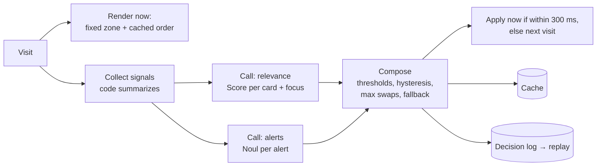

<div align="center">

# reflexui

**Adaptive, explainable screens driven by fast typed-judgment models.**

Interfaces that rearrange themselves around what matters right now.
A System One model ([Jev](https://typesafe.ai/blog/introducing-system-one-models-and-jev)) decides *what is relevant*;
your code decides *what is allowed*.

[](https://github.com/mmarqueti/reflexui/actions/workflows/ci.yml)
[](https://www.npmjs.com/package/@reflexui-jev/core)
[](LICENSE)
[](https://www.typescriptlang.org/)
[](#roadmap)
[](https://nodejs.org/)
[](CONTRIBUTING.md)

<sub>`adaptive-ui` · `personalization` · `generative-ui` · `dashboards` · `llm` · `system-one` · `jev` · `react` · `typescript` · `headless`</sub>

[Quick start](#quick-start) · [Why](#why) · [How it works](#how-it-works) · [Quick look](#a-quick-look) · [Packages](#packages) · [Roadmap](#roadmap) · [Contributing](#contributing)

</div>

> **Status: pre-alpha.** The core (`compose`, `decide`, `buildRequests`), the TypeSafe/Jev decider, the React hook with
> `<DebugPanel>`, and offline replay all work, are covered by tests, and were validated against the real Jev API in a
> browser. The API may change between releases. See the [Roadmap](#roadmap).

---

## Contents

- [Overview](#overview)
- [How it differs from similar projects](#how-it-differs-from-similar-projects)
- [Quick start](#quick-start)
- [Why](#why)
- [How it works](#how-it-works)
- [Core concepts](#core-concepts)
- [Project structure](#project-structure)
- [Packages](#packages)
- [Usage](#usage)
- [Configuration](#configuration)
- [Providers](#providers)
- [Examples](#examples)
- [Design principles](#design-principles)
- [Development](#development)
- [Roadmap](#roadmap)
- [Privacy](#privacy)
- [Contributing](#contributing)
- [License](#license)
- [Prior art](#prior-art)

---

## Overview

**reflexui** is a TypeScript monorepo for adaptive UI surfaces. Every card, alert, and suggestion already exists in your code with values you compute. A System One model such as [Jev](https://typesafe.ai/blog/introducing-system-one-models-and-jev) only *ranks, gates, and picks* among those items—returning typed answers with calibrated confidence in roughly 70–500 ms—while a policy layer in code applies thresholds, stability rules, and fallbacks.

Goal: screens that adapt to the moment, never show invented content, and never block rendering on the model.

| | |
| --- | --- |
| **Language** | TypeScript (ESM) |
| **Runtime** | Node.js 20+ |
| **Package manager** | pnpm 10 |
| **License** | MIT |
| **Published packages** | `@reflexui-jev/core`, `@reflexui-jev/providers`, `@reflexui-jev/react`, `@reflexui-jev/replay`, `@reflexui-jev/redis` |

---

## How it differs from similar projects

Projects such as [json-render + Jev](https://json-render.dev/docs/jev) and [jev-ui](https://github.com/etweisberg/jev-ui) use Jev to pick among candidates at render time: which spec to compose, or which branch, rank or gate to show. reflexui builds on the same idea and focuses on the part around the model call:

| | Typical Jev integration | reflexui |
| --- | --- | --- |
| **Unit of decision** | One component or spec, at render time | A whole surface: fixed zone, ranked adaptive zone, at most one alert, suggestions |
| **Inputs** | The data passed to the call | Signals over time: navigation, conversations, feedback and metrics, each summarized by your code |
| **Stability** | Per call | Policy in code: thresholds, hysteresis, pins and a cap on swaps per visit |
| **Fallback** | Up to the caller | Built in: cache, then default order, then static screen. Never an empty slot |
| **Explainability** | Up to the caller | Reasons come from templates and every decision is logged |
| **Evaluation** | Manual | Offline replay over labeled history, comparing hit rate, latency and cost with the default order |

In short, reflexui adapts **over time and across signals**, with **stability rules** and **offline replay** built in.

---

## Quick start

Requires Node.js 20+. Install:

```bash
pnpm add @reflexui-jev/core @reflexui-jev/providers
# optional
pnpm add @reflexui-jev/react react      # React hook and debug panel (react >= 18)
pnpm add @reflexui-jev/redis ioredis    # shared cache for production
pnpm add @reflexui-jev/replay           # offline evaluation
```

A surface, one visit, no API key (save as `quick.mjs` with `"type": "module"` in your `package.json`):

```ts
import { decide, defineSurface, MemoryStore } from "@reflexui-jev/core";
import { mockDecider } from "@reflexui-jev/providers";

const surface = defineSurface<{ plan: "free" | "pro" }>({
  id: "home",
  fixed: () => ["revenue"], // chosen by your code, never by the model
  defaultOrder: () => ["usage", "billing", "security"],
  items: [
    { id: "usage", kind: "card", area: "usage", title: "Usage" },
    { id: "billing", kind: "card", area: "billing", title: "Billing", eligible: (ctx) => ctx.plan !== "free" },
    { id: "security", kind: "card", area: "security", title: "Security" },
  ],
  signals: [],
  relevanceLevels: ["Nothing to see here.", "Worth a look.", "Needs attention today."],
  relevancePrompt: 'How important is the "{title}" card for this user today?',
});

const { immediate, fresh } = await decide({
  surface,
  ctx: { plan: "pro" },
  subjectId: "user-1",
  decider: mockDecider(), // swap for typesafeDecider() to use Jev
  store: new MemoryStore(),
});

console.log("immediate:", immediate.source, immediate.adaptive.map((p) => p.id)); // default order
console.log("fresh:    ", (await fresh).source, (await fresh).adaptive.map((p) => p.id)); // ranked
```

`mockDecider` answers with a deterministic hash, so the ranking is arbitrary. To get real judgments, create a TypeSafe key
and use Jev:

```bash
cp .env.example .env   # then set TYPESAFE_API_KEY
```

```ts
import { typesafeDecider } from "@reflexui-jev/providers";
// decider: typesafeDecider(),
```

Next steps: describe what changed with **signals** (see [Usage](#usage)), render the result with the
[React hook](#consume-on-the-client), keep state in Redis ([docs/redis.md](docs/redis.md)) and measure the ranking with
[replay](docs/replay.md).

For local work on this repository:

```bash
pnpm install
pnpm typecheck
pnpm build
pnpm test
```

---

## Why

Most dashboards show the same grid to everyone. The one number that needs attention today (late deliveries, a unit falling behind, a spike in churn risk) sits below the fold next to ten numbers that did not change.

Generative UI with LLMs can rebuild a screen per user, but it is slow (seconds), expensive, and can invent labels and numbers. **reflexui** takes a narrower path:

- every card, alert, and suggestion **already exists** with values computed by your code;
- a **System One model** such as [Jev](https://typesafe.ai/blog/introducing-system-one-models-and-jev) only *ranks, gates, and picks* among them;
- a **policy layer** in code applies thresholds, stability rules, and fallbacks.

The result: a screen that adapts to the moment, never shows invented content, and never blocks rendering on the model.

---

## How it works

A surface has two zones:

| Zone | Who decides | Changes when |
| --- | --- | --- |
| **Fixed zone** (first scroll) | Your code, from the subject's profile | The profile changes |
| **Adaptive zone** | The model ranks; the policy limits | Signals change; max N swaps per visit |

One visit:



The two model calls run in parallel. Each receives only the signals its questions need.

---

## Core concepts

| Concept | What it is | Where |
| --- | --- | --- |
| **Surface** | A screen definition: fixed zone, default order, items, signals, rubric, policy | `defineSurface()` |
| **Item** | A `card`, an `alert`, or a `suggestion`, with an eligibility rule and reason templates | `SurfaceItem` |
| **Signal** | A provider that turns raw data into a short, model-ready snapshot + structured facts | `SignalProvider` |
| **Question** | A typed question: `score` (rubric), `choice` (options), or `noul` (yes/no probability) | `score()`, `choice()`, `noul()` |
| **Decider** | Anything that answers typed questions: Jev via TypeSafe, a mock, or your own implementation | `Decider` |
| **Policy** | Thresholds and stability rules, all in code | `Policy`, `defaultPolicy` |
| **Decision** | What to render: fixed ids, ranked adaptive items, at most one alert, suggestions, reasons | `Decision` |
| **Replay** | Run the surface over labeled history and compare with the default order | `runReplay()` |

Full reference: [docs/concepts.md](docs/concepts.md).

---

## Project structure

```
packages/
  core/          # Types, questions, defineSurface, policy, compose, decide, stores
  providers/     # Deciders: TypeSafe (Jev) and a deterministic mock
  react/         # Headless useAdaptiveSurface, feedback and DebugPanel
  replay/        # Offline replay over labeled history
  redis/         # Redis-backed DecisionStore and FeedbackStore
examples/
  restaurant-kpis/   # Restaurant owner home (fictitious "Mesa Boa")
  saas-dashboard/    # Small B2B SaaS admin surface (domain-isolation check)
docs/
  concepts.md
  architecture.md
  writing-questions.md
  privacy.md
  replay.md
  redis.md
```

---

## Packages

| Package | Purpose | Status |
| --- | --- | --- |
| [`@reflexui-jev/core`](packages/core) | Types, question builders, `defineSurface`, policy, `compose`, `decide`, stores | Ready |
| [`@reflexui-jev/providers`](packages/providers) | Deciders: Jev via the TypeSafe API, and a deterministic mock | Ready |
| [`@reflexui-jev/react`](packages/react) | Headless `useAdaptiveSurface`, feedback helpers and `<DebugPanel>` | Ready |
| [`@reflexui-jev/replay`](packages/replay) | Offline replay: hit rate vs default order, latency, cost | Ready |
| [`@reflexui-jev/redis`](packages/redis) | Redis-backed `DecisionStore` and `FeedbackStore` for production | Ready |

---

## Usage

### Define a surface

`defineSurface()` is implemented today. This sketch matches the public API used in [`examples/restaurant-kpis`](examples/restaurant-kpis):

```ts
import { defineSurface } from "@reflexui-jev/core";

export const home = defineSurface<RestaurantCtx>({
  id: "restaurant-home",
  fixed: (c) =>
    c.units >= 2
      ? ["revenue", "orders", "avg-ticket", "revenue-per-unit"]
      : ["revenue", "orders", "avg-ticket", "avg-rating"],
  defaultOrder: () => ["delivery-time", "cancellation-rate", "rating-trend", "top-dishes"],
  items: [
    {
      id: "delivery-time",
      kind: "card",
      area: "delivery",
      title: "Total delivery time",
      eligible: (c) => c.hasDelivery,
      reasons: [{ when: "anomaly", text: "{metric} is {ratio}x the 28-day average" }],
    },
    {
      id: "alert-late-delivery",
      kind: "alert",
      area: "delivery",
      title: "Late-delivery complaints",
      question: "Do recent reviews point to a late-delivery problem?",
    },
    // ...
  ],
  signals: [metricsSignal, navigationSignal, chatSignal, reviewsSignal],
  relevanceLevels: [
    "Nothing changed in this area and the owner showed no recent interest in it.",
    "The owner looked at or asked about this area recently, but the numbers are normal.",
    "Numbers moved out of the normal range, or it keeps coming up in reviews or chat.",
    "There is an active problem in this area that needs action today.",
  ],
  relevancePrompt: 'How important is it for the owner to see "{title}" today?',
});
```

### Decide on the server

```ts
import { decide, MemoryStore } from "@reflexui-jev/core";
import { typesafeDecider } from "@reflexui-jev/providers";

const { immediate, fresh, trace } = await decide({
  surface: home,
  ctx,
  subjectId: ctx.restaurantId,
  decider: typesafeDecider(), // reads TYPESAFE_API_KEY
  store: new MemoryStore(),
});
// `immediate` never waits on the model (cache, else default order).
// `await fresh` resolves with the composed decision, or `immediate` on error/timeout.
// `await trace` adds the scoreboard and raw model I/O for debug panels.
```

`MemoryStore` is for demos and tests: it lives in one process. In production, with several instances or serverless functions, use `redisStore` and `redisFeedbackStore` from [`@reflexui-jev/redis`](packages/redis) so the cache, the pins and the "not useful" feedback are shared. Why this matters: [docs/redis.md](docs/redis.md).

### Consume on the client

```tsx
import { useAdaptiveSurface } from "@reflexui-jev/react";

const { decision, status, deferred, feedback } = useAdaptiveSurface({
  surfaceId: "restaurant-home",
  subjectId,
  endpoint: "/api/surface",
});
```

Return `decisionStream(await decide(...))` from the endpoint (add `{ trace: true }` in development to feed `<DebugPanel>`). The hook renders the immediate decision at once and swaps in the fresh one only if it arrives within `applyWithinMs`; otherwise it is exposed as `deferred` and used on the next visit.

### Fallback without the model (available today)

```ts
import { defaultDecision, defineSurface } from "@reflexui-jev/core";

const decision = defaultDecision(home, ctx, subjectId, Date.now());
// decision.source === "default"
```

---

## Configuration

Copy [`.env.example`](.env.example) and set your TypeSafe key. Without it, use `mockDecider()`.

```bash
cp .env.example .env
```

| Variable | Used by | Notes |
| --- | --- | --- |
| `TYPESAFE_API_KEY` | `typesafeDecider` | Jev through the TypeSafe API (early access). Read from `process.env`, or pass `apiKey` |

Never commit `.env`. Replay datasets under `replay-data/` are git-ignored on purpose.

---

## Providers

| Provider | Model / backend | Status |
| --- | --- | --- |
| `mockDecider` | Deterministic hash | Ready — runs examples and tests with no API key |
| `typesafeDecider` | Jev (TypeSafe direct) | Ready: `POST /v1/systemone`, retries, timeout |

```ts
import { typesafeDecider } from "@reflexui-jev/providers";

const decider = typesafeDecider({
  // all optional
  apiKey: process.env.TYPESAFE_API_KEY, // default
  model: "jev-1.13.0",                  // default "jev-latest"; pin it in production
  maxRetries: 2,                        // on 429/529 and network errors, with backoff
});
```

```ts
import { mockDecider } from "@reflexui-jev/providers";

const decider = mockDecider({
  // optional: force answers for specific question keys
  overrides: {},
  latencyMs: 0,
});
```

Another backend? A decider is just `{ name, evaluate(request) }` (the `Decider` interface from `@reflexui-jev/core`), so you can plug in your own.

---

## Examples

| Example | Domain | Shows |
| --- | --- | --- |
| [`examples/restaurant-kpis`](examples/restaurant-kpis) | Restaurant owner home | 19 cards, 5 alerts, 6 suggestions; 3 fictitious restaurants (delivery-first, dine-in bistro, 3-unit chain) |
| [`examples/saas-dashboard`](examples/saas-dashboard) | B2B SaaS admin home | Same core, different domain — proof that nothing is restaurant-specific |

These two define surfaces and fixtures. For something you can run, start with the [Quick start](#quick-start).

---

## Design principles

1. **Known rules stay in code.** If a structured field decides it, it is an `if`, not a question.
2. **The model never computes.** Deltas, averages, and dates are computed before the call.
3. **The model only chooses among what exists.** No model output becomes text on screen.
4. **Small context per call.** Each call gets only the signals its questions need.
5. **One question, one dimension.** Rubric levels describe situations, not adjectives.
6. **Stability over cleverness.** Fixed first scroll, few swaps per visit, hysteresis, pins.
7. **There is always a fallback.** Cache → default order → static screen. Never an empty slot.
8. **Every decision is explainable and logged.** Reasons come from templates; logs feed replay.

More: [docs/writing-questions.md](docs/writing-questions.md) · [docs/architecture.md](docs/architecture.md).

---

## Development

Requirements: **Node.js ≥ 20**, **pnpm 10** (see `packageManager` in the root `package.json`).

```bash
pnpm install      # install workspace deps
pnpm typecheck    # tsc --noEmit across the workspace
pnpm build        # build all packages (tsup)
pnpm changeset    # add a Changesets entry before release
```

`pnpm test` is wired at the root (`pnpm -r test`) for when packages add test scripts; none ship tests yet.

CI (`.github/workflows/ci.yml`) runs `pnpm install --frozen-lockfile`, `pnpm typecheck`, and `pnpm build` on `main` and pull requests.

---

## Roadmap

| Milestone | Scope | Status |
| --- | --- | --- |
| **M0** Access | `typesafeDecider`: Jev through the TypeSafe API | **Done.** Validated against the real API (manual runs and the replay script). No automated test in CI, since it would need a key |
| **M1** Core | `defineSurface`, `compose`, `decide`, `buildRequests`, `decisionStream`, feedback demotion, `useAdaptiveSurface` and `<DebugPanel>`, Redis stores | **Done.** Covered by tests; `0.2.0` is on npm |
| **M2** Replay | `runReplay`, labeling format, report, threshold sweeps | **Done.** See [docs/replay.md](docs/replay.md). It still needs real labeled cases to calibrate the defaults |
| **M3** First real-world case | Integration behind a flag, feedback, logs | **Next.** Exit criterion: p95 ≤ 500 ms and no instability complaints (end to end we measured about 300 to 700 ms with Jev) |
| **M4** Field test | A/B against the static screen | **Later.** Decision: ship, adjust, or stop |

### Known gaps

- **Defaults are not calibrated.** `minConfidence`, `alertThreshold` and the other policy values are educated guesses until
  you run replay on your own labeled cases. In our tests Jev's confidence varied a lot (about 0.45 to 0.97) and some
  alerts landed right on the threshold.
- **The last fallback step is yours.** The chain is cached decision, then `defaultOrder`; a static screen when even that is
  unavailable is up to your app.
- **Only Jev (TypeSafe) and a mock decider ship today.** The `Decider` interface is two lines, so adding another backend
  is a small adapter, but none is included.
- **The examples in `examples/` are definitions and fixtures.** For something runnable, use the [Quick start](#quick-start).

---

## Privacy

- Signals are summarized **before** leaving your system; send the smallest useful context.
- Remove personal data (names, phones, emails, tax ids, addresses) from chat and reviews first.
- Check the retention terms of your Jev provider.
- Replay datasets are git-ignored (`replay-data/`). Never commit real customer data.

Details: [docs/privacy.md](docs/privacy.md).

---

## Contributing

The API is still moving. Open an issue before large PRs. See [CONTRIBUTING.md](CONTRIBUTING.md).

```bash
pnpm install
pnpm typecheck
```

Guidelines in short:

- Keep the core **domain-free** — restaurant/SaaS specifics belong in `examples/`.
- Keep `compose` **pure** — no I/O; time comes in as `now`.
- Use **fictitious fixtures only**.

---

## License

[MIT](LICENSE)

---

## Prior art

- [json-render + Jev](https://json-render.dev/docs/jev) (Vercel Labs): composes UI specs from candidates with Jev.
- [jev-ui](https://github.com/etweisberg/jev-ui): `<Branch>`, `<Rank>`, `<Gate>` components backed by Jev.
- [Introducing System One models and Jev](https://typesafe.ai/blog/introducing-system-one-models-and-jev) (TypeSafe).
